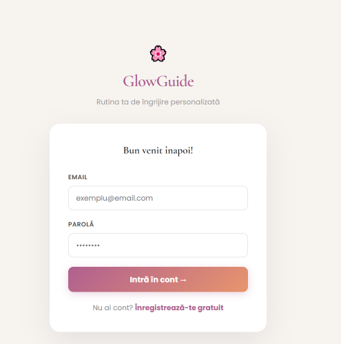
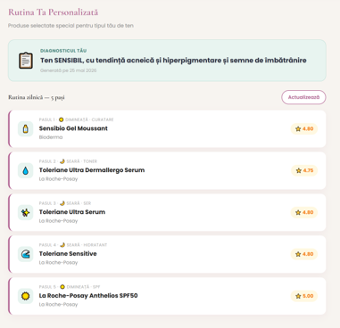
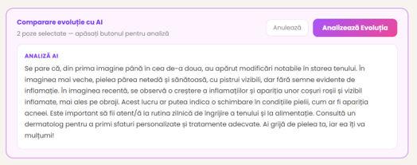
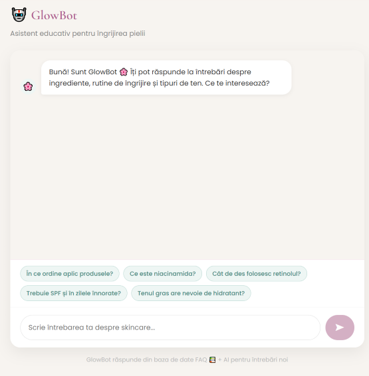
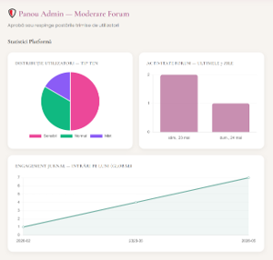

# GlowGuide

GlowGuide is a full-stack web application for personalized skincare routines. The platform uses a user's skin profile to generate tailored recommendations and provides tools for tracking progress over time.

The project combines a React frontend, a Node.js REST API and a MySQL database. It also includes data visualization, a community forum with moderation features and an AI-assisted chatbot.

## Main features

- Skin profile questionnaire
- Personalized skincare routine generation
- Rule-based product recommendations
- Daily progress journal
- Progress charts and data visualization
- User authentication and authorization
- Community forum with moderation features
- Public user profiles
- FAQ-based chatbot with an OpenAI fallback

## Screenshots

### Authentication



### Skin analysis questionnaire


### Personalized skincare routine



### AI-powered skin comparison



### GlowBot chatbot



### Admin dashboard




## Application architecture

```text
React + Vite frontend
        │
        │ REST API / Axios
        ▼
Node.js + Express backend
        │
        │ Sequelize ORM
        ▼
MySQL database
```

## Technology stack

### Frontend

- React
- Vite
- React Router
- Axios
- Chart.js
- react-chartjs-2

### Backend

- Node.js
- Express
- Sequelize
- MySQL
- JWT
- bcryptjs
- Nodemailer
- Cloudinary
- OpenAI API

## Repository structure

```text
GlowGuide/
├── glowguide-frontend/     # React and Vite application
├── glowguide-backend/      # Node.js and Express REST API
├── docs/                   # Technical documentation and SQL scripts
└── README.md
```

## Getting started

### Prerequisites

Before running the project locally, make sure you have:

- Node.js and npm;
- a MySQL server;
- a local database for GlowGuide.

### 1. Clone the repository

```bash
git clone https://github.com/madalinacrainiceanu/GlowGuide.git
cd GlowGuide
```

### 2. Set up the backend

```bash
cd glowguide-backend
npm install
Copy-Item .env.example .env
```

Complete the values in `.env` with your local database and service configuration, then start the backend:

```bash
npm run dev
```

### 3. Set up the frontend

Open a second terminal window and run:

```bash
cd GlowGuide/glowguide-frontend
npm install
npm run dev
```

The frontend and backend must both be running for the complete application to work locally.

## Environment variables

The backend uses environment variables for local configuration, including:

```text
PORT
DB_HOST
DB_USER
DB_PASSWORD
DB_NAME
JWT_SECRET
OPENAI_API_KEY
EMAIL_USER
EMAIL_PASS
```

Use `.env.example` as a reference. Never commit real passwords, API keys or other private credentials.

## Deployment

- Frontend: Vercel
- Backend and database: Railway

## Technical highlights

GlowGuide was developed as a full-stack application with a separate frontend and backend. The project includes relational database integration through Sequelize, JWT-based authentication, password hashing, rule-based recommendation logic, progress tracking, forum functionality and third-party service integrations.

## Future improvements

- Add automated unit and integration tests
- Improve API validation and error handling
- Add database migrations
- Restrict CORS to trusted production origins
- Add CI/CD checks
- Improve accessibility and recommendation explainability

## Disclaimer

GlowGuide provides general skincare information and is not a substitute for professional medical advice or consultation with a qualified dermatologist.
